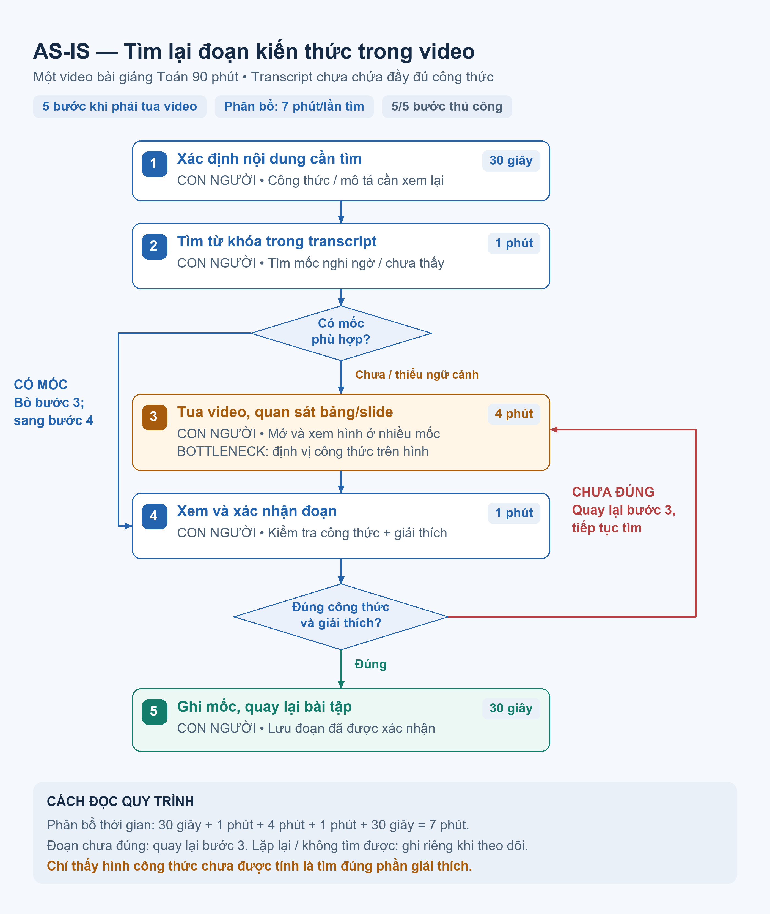
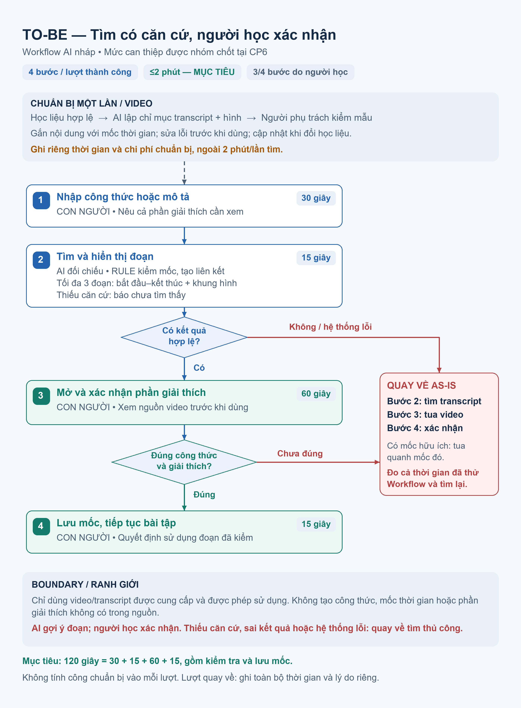

# Báo cáo nhóm — Day 02 Discovery & Problem Framing

> Bản chung của nhóm, viết trên repo do nhóm trưởng fork. Không copy file này sang repo cá nhân.
> Template chi tiết và prompt mẫu: [docs/01-worksheet.md](../../docs/01-worksheet.md). Bài mẫu: [docs/02-deliverable-example.md](../../docs/02-deliverable-example.md).

## 1. Thông tin nhóm

- Tên nhóm:
- Thành viên: xem `TEAM.md`
- Candidate problem được chọn (1 câu):
- Quyết định cuối: Go / Not Yet / No-Go

---

## 2. Hội tụ nhóm (CP3)

### 2.1. Pitch

| # | Người đưa ra | Candidate (Job Story ngắn) | Actor | Bottleneck | Câu hỏi phản biện nhận được (ai hỏi) |
|---:|---|---|---|---|---|
| 1 | | | | | |
| 2 | | | | | |
| 3 | | | | | |
| 4 | | | | | |
| 5 | | | | | |
| 6 | | | | | |
| 7 | | | | | |
| 8 | | | | | |
| 9 | | | | | |
| 10 | | | | | |
| 11 | | | | | |
| 12 | | | | | |

### 2.2. Cluster

| Cluster | Các candidate | Pattern chung |
|---|---|---|
| A | | |
| B | | |
| C | | |

### 2.3. Opportunity Solution Tree rút gọn

Gốc là **1 outcome**. Nhánh là **opportunity** (nhu cầu, pain), không phải tính năng hay công cụ.

```text
OUTCOME: 
├── Opportunity A: 
├── Opportunity B: 
└── Opportunity C: 
```

Những ý đã gạch bỏ vì là solution đội lốt opportunity:

-

### 2.4. Chấm điểm shortlist (1–5)

| Candidate | Actor rõ | Quy trình rõ | Pain có bằng chứng | Impact đo được | Vừa sức lab | So sánh được No AI/Rule/Workflow/Agent | Nhóm hiểu domain | Tổng |
|---|---:|---:|---:|---:|---:|---:|---:|---:|
| | | | | | | | | |
| | | | | | | | | |
| | | | | | | | | |

**Candidate được chọn:**

**Vì sao chọn:**

**Vì sao loại các candidate còn lại:**

**Xử lý bất đồng (nếu có):**

---

## 3. Kiểm chứng + research giải pháp đã có (CP4)

### 3.1. Assumption Map

| # | Giả định | Loại (Value / Usability / Feasibility / Viability) | Quan trọng (1–5) | Đã có bằng chứng (1–5) | Kiểm chứng trước? |
|---:|---|---|---:|---:|---|
| 1 | | | | | |
| 2 | | | | | |
| 3 | | | | | |
| 4 | | | | | |
| 5 | | | | | |
| 6 | | | | | |

*Điền 4–6 giả định; xóa dòng thừa.*

Giả định nhóm kiểm chứng trong buổi này:

### 3.2. Kiểm chứng

Cách đã dùng: Phỏng vấn / Survey / Log, ticket, review

Interview snapshot (mỗi buổi phỏng vấn một bảng, hoặc đặt file trong `report/assets/cp4-interview-snapshot-N.md`):

| Trường | Nội dung |
|---|---|
| Người được hỏi (vai trò, không ghi tên thật) | |
| Câu nói đáng nhớ nhất (nguyên văn) | |
| Lần gần nhất gặp vấn đề này: chuyện gì đã xảy ra? | |
| Hiện đang xử lý bằng cách nào (workaround)? | |
| Mất bao lâu, bao lần? | |
| Insight / opportunity rút ra | |

Tổng hợp:

| Nguồn | Số người / số mẫu | Tín hiệu xác nhận | Tín hiệu phản bác |
|---|---:|---|---|
| | | | |

**Nhóm đã sửa problem thế nào sau kiểm chứng:**

### 3.3. Research giải pháp đã có

| Công cụ / case / pattern | Link | Giải bước nào trong quy trình? | Điểm mạnh | Khoảng trống / rủi ro | Bài học cho nhóm |
|---|---|---|---|---|---|
| | | | | | |
| | | | | | |
| | | | | | |

---

## 4. Quy trình trước/sau (CP5)

**Bài toán:** Khi làm bài tập từ một video bài giảng Toán dài 90 phút, sinh viên cần tìm lại đúng đoạn có công thức và phần giải thích liên quan để tiếp tục làm bài.

**Phạm vi:** Một video có transcript nhưng chưa có mục lục chi tiết, người học có quyền sử dụng; công thức có thể chỉ xuất hiện trên bảng/slide và không được đọc đầy đủ. Quy trình bắt đầu khi người học xác định nhu cầu tìm lại kiến thức và kết thúc khi đã xác nhận đúng đoạn, lưu mốc rồi quay lại bài tập.

### 4.1. Quy trình hiện tại



| Bước | Actor | Input | Output | Thời gian phân bổ / lần tìm | Ghi chú |
|---:|---|---|---|---|---|
| 1. Xác định nội dung cần tìm | Sinh viên | Bài tập đang làm; công thức hoặc nội dung nhớ được | Từ khóa, công thức hoặc mô tả cần tìm | 30 giây | Xác định cả phần giải thích cần xem, không chỉ hình công thức. |
| 2. Tìm từ khóa trong transcript | Sinh viên | Mô tả từ bước 1; transcript của video | Mốc nghi ngờ hoặc xác định chưa tìm thấy đoạn phù hợp | 1 phút | Có mốc phù hợp thì sang bước 4; không tìm ra hoặc chỉ thấy từ khóa thiếu ngữ cảnh thì sang bước 3. |
| 3. Tua video, quan sát bảng/slide | Sinh viên | Video; công thức cần tìm; các mốc đã kiểm tra | Đoạn nghi ngờ có công thức và phần giải thích | 4 phút | **Bottleneck phân tích.** Phải mở và quan sát nhiều mốc khi transcript không chứa đủ nội dung trên hình. |
| 4. Xem và xác nhận đoạn giải thích | Sinh viên | Đoạn nghi ngờ từ bước 2 hoặc 3 | Xác nhận đúng công thức và đúng phần giải thích; hoặc xác định chưa đúng | 1 phút | Đúng thì sang bước 5; chưa đúng thì quay lại bước 3. Chỉ thấy công thức chưa được tính là tìm thành công. |
| 5. Ghi mốc và quay lại bài tập | Sinh viên | Đoạn đã xác nhận; mốc bắt đầu–kết thúc | Bookmark/ghi chú có mốc thời gian; tiếp tục làm bài | 30 giây | Cùng một sinh viên thực hiện cả 5 bước, không có chuyển giao giữa người. |

**Tổng thời gian phân bổ:** 30 giây + 1 phút + 4 phút + 1 phút + 30 giây = **7 phút/lần tìm**, cho luồng đi qua bước tua video và xác nhận đúng sau một lượt.

**Bottleneck chính:** Bước 3 — tua video và quan sát bảng/slide. Khi công thức trên hình không được đọc đầy đủ, tìm từ khóa trong transcript không đủ để định vị; người học phải mở và kiểm tra nhiều mốc trước khi đến được phần giải thích cần xem.

**Cách đọc sơ đồ:** Nếu tìm được ngay bằng transcript thì bỏ qua bước 3; nếu đoạn chưa đúng thì quay lại bước 3. Các lượt phải lặp lại hoặc không tìm được được ghi riêng khi theo dõi quy trình.

### 4.2. Quy trình tương lai

**Phương án đề xuất:** Workflow có AI hỗ trợ tìm đoạn; người học vẫn xác nhận kết quả. Đây là bản đề xuất CP5 để nhóm so sánh với No AI/Rule và chốt mức can thiệp tại CP6.



**Chuẩn bị một lần, ngoài thời gian mỗi lượt tìm:** Người phụ trách học liệu cung cấp video và transcript được phép sử dụng; hệ thống đối chiếu transcript với khung hình bảng/slide để lập chỉ mục theo thời gian. Người phụ trách học liệu kiểm tra mẫu mốc thời gian và căn cứ; có lỗi thì sửa trước khi dùng. Khi đổi video/transcript, cập nhật và kiểm tra lại chỉ mục. Ghi riêng thời gian, chi phí và công sức chuẩn bị khi thử nghiệm.

| Bước | Actor / loại xử lý | Input | Output | Thời gian mục tiêu / lần tìm | Ghi chú |
|---:|---|---|---|---|---|
| 1. Nhập công thức hoặc mô tả | **Con người:** sinh viên | Bài tập; công thức hoặc mô tả phần giải thích cần xem | Yêu cầu tìm trong video đã lập chỉ mục | 30 giây (0,5 phút) | Có thể dùng mô tả khi không nhớ chính xác cách viết công thức. |
| 2. Tìm và hiển thị đoạn có căn cứ | **AI + Rule:** hệ thống | Yêu cầu; chỉ mục transcript và hình bảng/slide | Tối đa 3 đoạn, mỗi đoạn có mốc bắt đầu–kết thúc, liên kết mở video và khung hình liên quan; hoặc báo chưa tìm thấy | 15 giây (0,25 phút), gồm thời gian chờ hệ thống | AI đối chiếu nội dung; Rule kiểm tra mốc trong phạm vi video, tạo liên kết và giới hạn số kết quả. Có kết quả hợp lệ thì sang bước 3; không có căn cứ hoặc hệ thống lỗi thì quay về As-Is. |
| 3. Mở và xác nhận phần giải thích | **Con người:** sinh viên | Các đoạn và căn cứ từ bước 2 | Xác nhận có đúng công thức và phần giải thích cần tìm; hoặc bác bỏ kết quả | 60 giây (1 phút), ngân sách cho việc mở và kiểm tra các kết quả | Chỉ chấp nhận sau khi xem nguồn video. Nếu mọi kết quả đều sai, thiếu ngữ cảnh hoặc không mở được thì quay về As-Is. |
| 4. Lưu mốc và tiếp tục bài tập | **Con người:** sinh viên | Đoạn đã được xác nhận | Bookmark/ghi chú có mốc thời gian; quay lại bài tập | 15 giây (0,25 phút) | Người học quyết định có sử dụng đoạn đó. |

**Tổng thời gian mục tiêu:** 30 + 15 + 60 + 15 = **120 giây = 2 phút/lần tìm thành công**. Thời gian tìm và xác nhận đúng đoạn ở bước 1–3 nằm trong ngân sách 105 giây; 15 giây còn lại dành cho lưu mốc và quay lại bài. Nếu kiểm tra lâu hơn thì ghi thời gian thực tế, không cắt ngắn việc kiểm tra để đạt mục tiêu.

**Boundary:**

- Chỉ xử lý video/transcript được cung cấp và được phép sử dụng; không tìm sang nguồn khác ngoài phạm vi đã thống nhất.
- Không tự tạo công thức, mốc thời gian, căn cứ hoặc phần giải thích thay cho nội dung gốc. Không có căn cứ trong video thì báo **chưa tìm thấy**.
- Kết quả là gợi ý đoạn để mở xem; AI không tự xác nhận người học đã tìm đúng hoặc hiểu đúng kiến thức. Người học kiểm tra video trước khi sử dụng; người phụ trách học liệu kiểm tra chỉ mục trước khi đưa vào dùng.

**Phương án quay về:**

| Tình huống | Xử lý | Người thực hiện |
|---|---|---|
| Chưa có chỉ mục, chỉ mục lỗi, không có kết quả có căn cứ hoặc hệ thống ngừng hoạt động | Báo rõ chưa tìm thấy/lỗi; quay lại bước 2 của As-Is để tìm transcript, sau đó tua video nếu cần | Sinh viên; người phụ trách học liệu xử lý chỉ mục riêng |
| Mọi kết quả được trả về (tối đa 3) đều sai, thiếu phần giải thích hoặc mốc/liên kết không dùng được | Bỏ kết quả gợi ý; quay lại bước 2–3 của As-Is, xem và xác nhận trước khi lưu mốc | Sinh viên |
| Đã tìm được mốc hữu ích nhưng phần giải thích chưa đủ | Dùng mốc đó làm điểm bắt đầu để tua quanh đoạn, tiếp tục bước 3–4 của As-Is | Sinh viên |

Lượt phải quay về được ghi là **lượt dùng phương án thủ công**; đo tổng thời gian từ lúc bắt đầu tìm, gồm cả thời gian thử Workflow và tìm lại, tránh chỉ báo cáo những lượt thành công nhanh.

### 4.3. Before / after

| Chỉ số | Trước — phân bổ thời gian | Sau — mục tiêu | Ghi chú / cách kiểm soát |
|---|---|---|---|
| Số bước trên luồng tìm thành công | 5, khi phải tua video | 4 | Đếm theo các bước đánh số trên sơ đồ, không tính nút rẽ nhánh hoặc công chuẩn bị một lần. Luồng transcript tìm được ngay có 4 bước; lượt lặp/quay về ghi riêng. |
| Tổng thời gian/lần tìm | 7 phút | Không quá 2 phút, gồm mở và kiểm tra đoạn, lưu mốc, quay lại bài tập | Khi kiểm tra, bấm giờ từ lúc bắt đầu tìm đến khi lưu được đoạn đúng và quay lại bài tập, tính cả thời gian chờ và tìm lại. Nếu transcript tìm được ngay thì bỏ thời gian tua video. |
| Số bước thủ công | 5/5 | 3/4 | Nhập yêu cầu, kiểm tra và lưu mốc vẫn do người học thực hiện. Nếu quay về As-Is thì ghi thêm thao tác thực tế. |
| Bottleneck chính | Tua video và quan sát bảng/slide | Người học kiểm tra đoạn: mục tiêu 1 phút | Giữ bước kiểm tra để tránh nhận nhầm công thức hoặc thiếu ngữ cảnh. |
| Rủi ro tìm sai hoặc thiếu phần giải thích | Người học có thể bỏ sót đoạn khi tua | AI có thể gợi ý sai đoạn hoặc chỉ tìm thấy hình công thức | Hiển thị khung hình và mốc thời gian; người học mở video để xác nhận cả phần giải thích. |
| Rủi ro mới phát sinh | Chưa phụ thuộc chỉ mục hoặc hệ thống tìm đoạn | Nhận dạng sai công thức, mốc thời gian sai, chỉ mục cũ hoặc hệ thống lỗi | Kiểm tra mẫu chỉ mục; Rule kiểm tra mốc; cập nhật khi đổi học liệu; luôn có đường quay về As-Is. |
| Công chuẩn bị một lần | Mở video và transcript; chuẩn bị ghi chú hoặc bookmark để lưu mốc | Cung cấp video/transcript; lập chỉ mục transcript kết hợp hình bảng/slide; kiểm tra mẫu mốc thời gian và cập nhật khi đổi học liệu | Ghi riêng thời gian và chi phí chuẩn bị/cập nhật, không tính bằng 0 và không gộp vào 2 phút/lần tìm. |
| Xử lý khi tìm chưa đúng | Tiếp tục tua và quan sát bảng/slide; lặp bước tìm đoạn và xác nhận cho đến khi tìm đúng hoặc dừng tìm | Quay về tìm transcript và tua thủ công khi không có kết quả có căn cứ, mọi đoạn gợi ý đều sai, liên kết lỗi hoặc hệ thống ngừng hoạt động | Nếu có mốc hữu ích thì tua quanh mốc đó. Ghi số lượt, lý do và tổng thời gian gồm cả thử Workflow lẫn thao tác thủ công. |

---

## 5. Problem Statement v0 (CP5)

| Trường | Nội dung |
|---|---|
| **Actor** | |
| **Quy trình** | |
| **Bottleneck** | |
| **Impact** | |
| **Success Metric** (baseline → target, cách đo) | |
| **Boundary** (AI không được làm gì; khi nào cần con người kiểm tra — HITL) | |

Phản biện nhận được (từ AI hoặc nhóm khác) và nhóm có đồng ý không:

-

---

## 6. Mức can thiệp AI (CP6)

### 6.1. Ma trận độ mơ hồ × độ phức tạp

Bài của nhóm nằm ở ô:

Vì sao:

### 6.2. So sánh 4 mức

| Mức | Phương án cho bài của nhóm | Đủ khi nào | Rủi ro | Chọn? |
|---|---|---|---|---|
| **No AI** (sửa quy trình) | | | | |
| **Rule** | | | | |
| **Workflow** | | | | |
| **Agent** | | | | |

**Mức chọn:**

**Vì sao không chọn mức đơn giản hơn:**

### 6.3. AI Canvas rút gọn

| Thành phần | Nội dung |
|---|---|
| **Prediction** — AI dự đoán / tạo ra gì? | |
| **Judgment** — con người cân nhắc, quyết định gì? | |
| **Action** — hành động cuối cùng là gì, ai làm? | |
| **Outcome** — đo kết quả bằng gì? | |
| **Input** — AI cần dữ liệu đầu vào gì mỗi lần chạy? Có sẵn không? | |
| **Feedback** — lấy phản hồi ở đâu để cải thiện? | |

### 6.4. Hai câu hỏi của Google PAIR

- Người dùng muốn **được hỗ trợ (augment)** hay **giao hẳn việc (automate)**? Bằng chứng:
- AI sai kiểu nào tệ hơn, **báo nhầm** hay **bỏ sót**? Vì sao, và thiết kế đã xử lý thế nào:

---

## 7. Problem Statement v1 + tiêu chí đánh giá (CP6)

| Trường | Nội dung |
|---|---|
| **Actor** | |
| **Quy trình** | |
| **Bottleneck** | |
| **Impact** | |
| **Success Metric** (baseline → target, cách đo) | |
| **Boundary** | |
| **AI intervention point** | |
| **Mức chọn** | No AI / Rule / Workflow / Agent |
| **Rủi ro & người kiểm tra** | |

**Thay đổi so với v0 và lý do:**

| Trường | v0 | v1 | Vì sao đổi |
|---|---|---|---|
| | | | |

**Tiêu chí đánh giá đầu ra của AI (3–5 tiêu chí):**

| # | Tiêu chí | Đạt khi | Không đạt khi |
|---:|---|---|---|
| 1 | | | |
| 2 | | | |
| 3 | | | |

---

## 8. Quyết định (CP6)

### 8.1. Bốn rủi ro

| Rủi ro | Câu hỏi | Mức độ rủi ro (Thấp = an toàn / TB / Cao = nguy hiểm) | Lý do / bằng chứng |
|---|---|---|---|
| **Value** | Người dùng có thật sự cần và sẽ dùng không? | | |
| **Usability** | Người dùng có dùng được, có hiểu và sửa được đầu ra của AI không? | | |
| **Feasibility** | Có đủ dữ liệu, công cụ, kỹ năng để làm không? | | |
| **Viability** | Có hợp chi phí, pháp lý, quy định tổ chức không? Ai vận hành? | | |

### 8.2. Kết luận

**Quyết định:** Go / Not Yet / No-Go

**Lý do:**

**Nếu Go — pilot nhỏ nhất:**

**Nếu Not Yet — cần kiểm chứng gì trước:**

**Nếu No-Go — nên làm gì thay AI:**

**Ngưỡng dừng** (nếu sau … mà … thì quay về …):

---

## 9. Hạn chế và hướng tiếp theo

-

## 10. Tài liệu tham khảo

-
