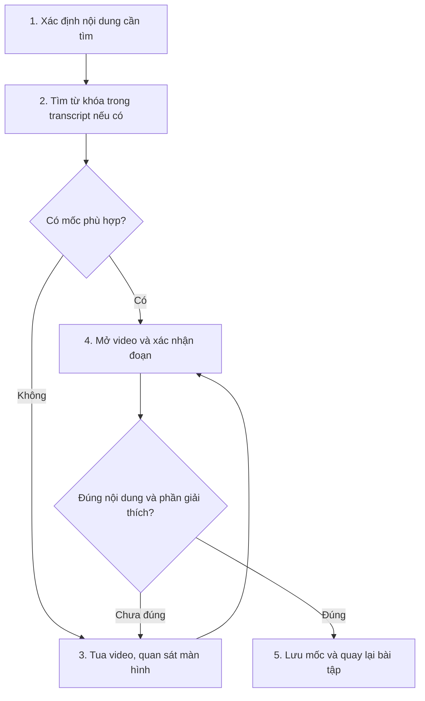
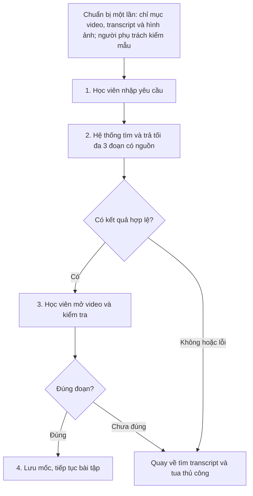

# Báo cáo nhóm — Day 02 Discovery & Problem Framing

**Nhóm E1 · Lớp L3B**

## 1. Thông tin nhóm

- **Thành viên:** Nguyễn Đức Minh, Phạm Thế Hùng, Trương Thị Thu Hà, Đào Thị Ngọc Ánh. Phân công và bằng chứng đóng góp tại [TEAM.md](../../TEAM.md).
- **Candidate problem:** Học viên AI20K mất thời gian định vị đoạn code hoặc phần giải thích cần xem lại trong video bài giảng khi làm bài tập/lab.
- **Kết quả kiểm chứng:** Survey 7 học viên xác nhận nhu cầu lặp lại, nhưng thời gian tự báo cáo thấp hơn giả định ban đầu và chưa chứng minh lợi ích của AI so với mục lục hoặc transcript.
- **Quyết định:** **Not Yet** — chưa xây sản phẩm; đo baseline và so sánh các phương án bằng công cụ sẵn có trước.

---

## 2. Hội tụ nhóm (CP3)

### 2.1. Pitch

Nhóm 4 người, 12 candidate. Thời gian là ước lượng từ CP2.

| # | Người đưa ra | Candidate (Job Story ngắn) | Actor | Bottleneck | Phản biện nhận được (người góp ý) |
|---:|---|---|---|---|---|
| 1 | Nguyễn Đức Minh — Card #1 | Khi chấm bài toán viết tay, tôi muốn xác định bước sai đầu tiên và loại lỗi, để hướng dẫn học sinh sửa đúng nguyên nhân. | Giáo viên Toán THCS | Kiểm tra từng phép biến đổi, tìm bước sai và phân loại lỗi: 2/5 phút/bài. | Nhóm: có ích nhưng lo chi phí xây dựng/huấn luyện và vận hành AI. |
| 2 | Nguyễn Đức Minh — Card #2 | Khi làm bài tập từ video 90 phút, tôi muốn tìm đúng đoạn giải thích công thức, để tiếp tục làm bài mà không phải tua nhiều đoạn. | Sinh viên học qua video | Tua và quan sát bảng/slide khi transcript không đủ: 4/7 phút/lần tìm. | Nhóm cân nhắc cùng Card #3 của Minh và cuối cùng chọn card này. |
| 3 | Nguyễn Đức Minh — Card #3 | Khi nhận đơn bán sỉ qua tin nhắn, ảnh và ghi âm, tôi muốn xác định đúng mã hàng, số lượng và đơn vị, để nhập đơn và tránh giao nhầm. | Nhân viên nhập đơn nhà phân phối thực phẩm | Tra SKU, đơn vị và lịch sử: 1,5/4 phút thao tác/đơn; chưa tính chờ xác nhận. | Nhóm cân nhắc cùng Card #2 của Minh trước khi chốt. |
| 4 | Phạm Thế Hùng — Card #1 | Khi đánh giá CV, tôi muốn biết kinh nghiệm và kỹ năng đáp ứng tiêu chí nào trong mô tả công việc, để chọn hồ sơ phù hợp. | Chuyên viên tuyển dụng | Đối chiếu từng tiêu chí: 1,1/2 phút/CV. | Nhóm: TopCV đã giải quyết bài toán tương tự; cần kiểm tra phạm vi ở CP4. |
| 5 | Phạm Thế Hùng — Card #2 | Khi tài liệu nằm ở nhóm chat, email và hệ thống học tập, tôi muốn tìm đúng tài liệu, để bắt đầu làm bài kịp thời. | Sinh viên | Tìm từ khóa, đọc tin và mở liên kết qua nhiều kênh: 4/8 phút/lần. | Phản biện tham khảo: thư mục chung và danh mục liên kết đã đủ chưa? Làm sao bảo đảm đúng phiên bản và quyền truy cập? Chưa có căn cứ cần Agent. |
| 6 | Phạm Thế Hùng — Card #3 | Khi có danh sách căn hộ, tôi muốn biết từng căn đáp ứng yêu cầu nào của khách, để chọn phương án phù hợp ngân sách và nhu cầu. | Nhân viên môi giới căn hộ | Đối chiếu 6 căn theo 5 tiêu chí: 6/12 phút/yêu cầu. | Phản biện tham khảo: bộ lọc Sheets theo 5 tiêu chí đã đủ chưa? Giá và tình trạng giao dịch có được cập nhật không? Cần tách tiêu chí bắt buộc với ưu tiên. |
| 7 | Trương Thị Thu Hà — Card #1 | Khi notebook báo lỗi, tôi muốn xác định dòng lỗi và nguyên nhân, để sửa nhanh thay vì thử nhiều lần. | Học viên AI20K làm lab Python/notebook | Xác định nguyên nhân và tìm hướng xử lý ở bước 2–3: 55/90 phút/lần. | Nhóm: chatbot AI hiện có có thể hỗ trợ tốt, chưa thấy lý do tự xây AI mới. |
| 8 | Trương Thị Thu Hà — Card #2 | Khi nhận đề lab, tôi muốn xác định đủ yêu cầu và thứ tự thực hiện, để không bỏ sót tiêu chí. | Học viên AI20K | Đọc và tổng hợp yêu cầu nằm ở nhiều file, bước 2–3: 35/50 phút/đề. | Nhóm: chatbot AI hiện có có thể hỗ trợ tốt, chưa thấy lý do tự xây AI mới. |
| 9 | Trương Thị Thu Hà — Card #3 | Khi nộp bài lab, tôi muốn xác định đúng tên repo và file, để tránh sai quy định nộp bài. | Học viên AI20K; coach | Xác minh cách đặt tên giữa các nguồn ở bước 3: khoảng 15 phút. | Nhóm: chatbot AI hiện có có thể hỗ trợ tốt, chưa thấy lý do tự xây AI mới. |
| 10 | Đào Thị Ngọc Ánh — Card #1 | Khi bệnh nhân thanh toán, tôi muốn có đủ dịch vụ đã dùng và phần bảo hiểm chi trả, để xuất hóa đơn nhanh và đúng. | Nhân viên thanh toán viện phí | Gom dịch vụ, đối chiếu và kiểm tra điều kiện bảo hiểm ở bước 2–4: 8/12 phút/hồ sơ. | Nhóm: AI chỉ hỗ trợ một phần; con người vẫn phải xác nhận do dữ liệu và thanh toán nhạy cảm. |
| 11 | Đào Thị Ngọc Ánh — Card #2 | Khi nhận nhiều hóa đơn cuối tháng, tôi muốn có đủ trường dữ liệu trong phần mềm kế toán, để chốt sổ đúng hạn mà không gõ lại từng dòng. | Kế toán viên doanh nghiệp vừa và nhỏ | Đọc và gõ tay từng trường: khoảng 3 phút/hóa đơn. | Nhóm: đã có công cụ chuyển dữ liệu hóa đơn vào phần mềm; cần kiểm tra phạm vi ở CP4. |
| 12 | Đào Thị Ngọc Ánh — Card #3 | Khi nhận yêu cầu xác minh tốt nghiệp, tôi muốn tìm hồ sơ đầy đủ, để trả lời đúng hạn mà không lục nhiều nguồn. | Chuyên viên Phòng Đào tạo/Công tác sinh viên | Tìm Excel, sổ gốc và đối chiếu định dạng ở bước 3–5: 20–60 phút/yêu cầu khóa cũ. | Nhóm: trọng tâm là lưu trữ, chuẩn hóa và truy xuất cơ sở dữ liệu. |

### 2.2. Cluster

| Cluster | Các candidate | Pattern chung |
|---|---|---|
| A — Tìm lại thông tin đã có | #2 Tìm đoạn kiến thức trong video; #5 Tìm tài liệu học tập; #12 Tra cứu hồ sơ tốt nghiệp | Biết thông tin đã tồn tại nhưng khó tìm đúng vị trí hoặc bản ghi vì nội dung dài, phân tán hoặc thiếu chỉ mục thống nhất. |
| B — Hiểu nội dung và xác định điểm vướng | #1 Tìm bước giải sai; #7 Debug notebook; #8 Đọc hiểu đề lab | Phải đọc nội dung, hiểu ngữ cảnh và xác định lỗi hoặc yêu cầu trước khi có thể tiếp tục công việc. |
| C — Chuẩn hóa và đối chiếu dữ liệu | #3 Chuẩn hóa đơn bán sỉ; #4 Đối chiếu CV; #6 Đối chiếu căn hộ; #10 Thanh toán viện phí; #11 Nhập hóa đơn | Chuyển thông tin nhiều định dạng thành trường/tiêu chí rõ rồi kiểm tra với danh mục, yêu cầu hoặc hồ sơ liên quan. |
| D — Kiểm tra quy định trước khi nộp | #9 Đặt tên repo và file | Phải xác minh và áp dụng đúng quy tắc để tránh sai sót khi nộp bài; có khả năng giải bằng checklist hoặc kiểm tra theo rule. |

### 2.3. Opportunity Solution Tree rút gọn

```text
OUTCOME: Giảm thời gian sinh viên tìm lại kiến thức trong video bài giảng dài,
         đồng thời tìm đúng phần giải thích cần xem.
├── Opportunity: Không nhớ mốc thời gian nên phải tua và xem nhiều đoạn.
├── Opportunity: Công thức trên bảng/slide không có đầy đủ trong transcript.
└── Opportunity: Công thức xuất hiện nhiều lần, khó tìm đúng phần giải thích.
     ✗ "Chatbot hỏi đáp video"       ← solution, gạch khỏi tầng này
     ✗ "Tự động tạo mục lục video"   ← solution, gạch khỏi tầng này
```

### 2.4. Chấm điểm shortlist (1–5)

Điểm tham khảo dựa trên CP2, có hỗ trợ AI, tối đa 35 điểm. Bằng chứng pain còn hạn chế vì chưa đo thời gian thực tế.

| Candidate | Actor rõ | Quy trình rõ | Pain có bằng chứng | Impact đo được | Vừa sức lab | So sánh được No AI/Rule/Workflow/Agent | Nhóm hiểu domain | Tổng |
|---|---:|---:|---:|---:|---:|---:|---:|---:|
| Tìm kiến thức trong video — Minh, Card #2 | 5 | 5 | 2 | 4 | 4 | 5 | 4 | **29** |
| Xử lý hóa đơn — Ngọc Ánh, Card #2 | 5 | 5 | 2 | 4 | 4 | 4 | 2 | **26** |
| Đọc tin khóa học, tìm tài liệu — Hùng, Card #2 | 5 | 4 | 2 | 4 | 4 | 4 | 4 | **27** |

**Chọn:** Tìm lại đoạn kiến thức trong video bài giảng dài — Card #2 của Nguyễn Đức Minh.

**Vì sao chọn:** Actor rõ, phạm vi giới hạn trong một video 90 phút; đo được thời gian tìm và độ đúng của đoạn trả về. Có thể so sánh tìm thủ công, mục lục/bookmark và tìm kiếm có AI.

**Vì sao chưa chọn hai candidate còn lại:** Xử lý hóa đơn có quy trình nhiều bước, đòi hỏi kiến thức chuyên sâu về kế toán mà nhóm chưa đáp ứng đủ. Đọc tin khóa học để tìm tài liệu phải gom thông tin nhiều kênh, có thể cải thiện trước bằng danh mục liên kết, thư mục chung và quy tắc phiên bản.

**Bất đồng:** Ban đầu có ý kiến muốn chọn xử lý hóa đơn. Sau khi thảo luận, nhóm nhận thấy quy trình nhiều bước và cần kiến thức chuyên sâu về kế toán nên thống nhất không chọn, chuyển sang tìm lại đoạn kiến thức trong video bài giảng dài.

---

## 3. Kiểm chứng + research giải pháp đã có (CP4)

### 3.1. Assumption Map

Nhóm ưu tiên kiểm chứng các giả định Value (#1–#4) bằng survey. Điểm quan trọng và mức bằng chứng chấm theo thang 1–5; mức bằng chứng phản ánh thông tin hiện có, kể cả bằng chứng phản bác giả định.

| # | Giả định | Loại | Quan trọng | Bằng chứng | Kết quả / cách kiểm tiếp |
|---:|---|---|---:|---:|---|
| 1 | Học viên tìm lại đoạn kiến thức ít nhất 1 lần/tuần | Value | 5 | 4 | 7/7 tự báo cáo ít nhất 1 lần/tuần; xác nhận trong mẫu survey |
| 2 | Mỗi lần tìm mất trên 5 phút | Value | 5 | 4 | Phản bác trong mẫu: 0/7 trên 5 phút; 5/7 từ 2–5 phút |
| 3 | Transcript không giúp được vì nội dung chỉ có trên bảng/slide | Value | 4 | 3 | 2/7 nêu trường hợp này, nhưng chỉ 1/7 dùng transcript; chưa đủ để coi đây là bottleneck phổ biến |
| 4 | Học viên chưa có cách thay thế đủ tốt | Value | 4 | 3 | Chưa xác nhận: 6/7 tua tay nhưng 5/7 vẫn tìm được; 3/7 đã hỏi ChatGPT/AI |
| 5 | Hệ thống định vị đúng nội dung qua lời nói và hình ảnh | Feasibility | 5 | 1 | Chưa thử; đánh giá trên bộ yêu cầu ở mục 7 |
| 6 | Có quyền xử lý video và có người chi trả, vận hành | Viability | 4 | 1 | Chưa xác nhận với giảng viên/nhà trường; việc 7/7 từng trả phí AI học tập không chứng minh sẵn sàng trả phí cho giải pháp này |

### 3.2. Kiểm chứng

**Phương pháp:** Google Form ẩn danh gồm 12 câu hỏi về hành vi đã xảy ra, gửi học viên AI20K ở nhóm khác ngày **09/11/2026**; nhận **7 phản hồi**. Nhóm dùng survey thay cho phỏng vấn. Nguồn bảng hỏi: [Google Form khảo sát](https://docs.google.com/forms/d/1S7OU5Z8xdmwR74fuGIxfLo-q06BbBohvUR3XCLs4qk4/viewform).

**Kết quả survey:**

| Câu hỏi | Kết quả |
|---|---|
| Có xem lại video bài giảng trong 2 tuần qua | 7/7 có; lần tìm gần nhất: 4/7 hôm nay, 3/7 tuần trước |
| Số lần tìm lại trong 1 tuần | 5/7 từ 2–3 lần; 2/7 1 lần |
| Thời gian mỗi lần | 5/7 từ 2–5 phút; 2/7 dưới 2 phút; 0/7 trên 5 phút |
| Kết quả tìm | 5/7 tìm được; 2/7 tìm được nhưng không chắc đúng đoạn; 0/7 bỏ cuộc |
| Cách đã dùng (chọn nhiều) | 6/7 tua thủ công; 3/7 xem slide PDF; 3/7 hỏi ChatGPT/AI; 2/7 ghi chú; 2/7 hỏi bạn/coach; 1/7 transcript |
| Bước tốn thời gian nhất | 4/7 tua tìm đúng đoạn; 2/7 nhớ nội dung ở buổi/video nào; 1/7 xem lại để hiểu |
| Lý do transcript không ra (chọn nhiều) | 3/7 chưa từng dùng transcript; 3/7 từ khóa khác lời giảng viên; 2/7 nội dung chỉ có trên slide/bảng; 2/7 video không có transcript |
| Nội dung cần tìm | Đoạn code, giải thích code, giải thích khái niệm (BoW), hướng dẫn thao tác Word; không ai nhắc tới công thức |
| Cách tự đối phó | 3/7 chụp màn hình; 1/7 ghi chú; 4/7 để trống |
| Đã trả tiền cho công cụ hỗ trợ học (3 tháng) | 7/7 ChatGPT Plus hoặc AI trả phí; 1/7 thêm app ghi chú/học tập trả phí |
| Mức đáng giải quyết (1–5) | Trung bình 3,7; 5/7 chấm ≥ 4 |

| Nguồn | Số mẫu | Tín hiệu xác nhận | Tín hiệu phản bác |
|---|---:|---|---|
| Survey học viên AI20K | 7 | Nhu cầu tìm lại có thật và lặp lại; 4/7 mất thời gian nhất ở bước tua tìm; 2/7 chưa chắc đúng đoạn | Không ai tự báo cáo trên 5 phút/lần hoặc nêu nhu cầu tìm công thức; 5/7 vẫn tìm được; đã có cách thay thế như slide, ghi chú và ChatGPT |

**Điều chỉnh sau kiểm chứng:** Nhóm chuyển trọng tâm từ “tìm công thức chỉ có trên bảng” sang **“định vị đoạn code hoặc phần giải thích cần xem lại”**. Mốc 7 phút/lần của CP2 không được survey xác nhận; baseline sơ bộ là 2–5 phút/lần ở 5/7 người, còn 2/7 dưới 2 phút. Tần suất 2–3 lần/tuần ở 5/7 cho thấy nhu cầu lặp lại, nhưng chưa đủ để kết luận mức tiết kiệm hoặc suy rộng tác động cho cả lớp. Nhóm ưu tiên so sánh với mục lục, bookmark và transcript.

Hai người nêu việc nhớ nội dung ở video nào là bước tốn thời gian nhất. Thử nghiệm đầu tiên giới hạn trong một video đã chọn để đo riêng bước định vị đoạn; tìm trên nhiều video là phạm vi xem xét sau.

### 3.3. Research giải pháp đã có

Các bước được đối chiếu theo quy trình ở mục 4.1: xác định nội dung → tìm transcript → tua và quan sát → xác nhận → lưu mốc.

| Công cụ / nghiên cứu | Nguồn | Giải bước nào? | Điểm mạnh | Khoảng trống / rủi ro | Bài học cho nhóm |
|---|---|---|---|---|---|
| Panopto Smart Search | [Video Search](https://www.panopto.com/features/video-search/) | Bước 2–3: tìm theo lời nói, chữ trên màn hình và slide | ASR/OCR tạo chỉ mục tìm kiếm và hỗ trợ định vị nội dung video | Chưa được nhóm thử trên video tiếng Việt, code hoặc chữ viết tay của khóa | Dùng tìm từ khóa kết hợp chỉ mục làm phương án so sánh; chưa có căn cứ phải tự xây AI |
| Google NotebookLM | [Giới thiệu hỗ trợ YouTube](https://blog.google/innovation-and-ai/products/notebooklm-audio-video-sources/) | Bước 2 và hỗ trợ bước 4: hỏi nội dung với trích dẫn transcript | Có thể khai thác video YouTube công khai qua nguồn transcript theo bài giới thiệu | Nguồn này chưa chứng minh khả năng tìm nội dung chỉ có trên hình; không suy rộng thành kết luận về mọi tính năng hiện tại | Kiểm thử riêng câu hỏi có thông tin trong lời nói và câu hỏi chỉ có trên màn hình |
| Gemini API | [Video understanding](https://aistudio.google.com/docs/video-understanding) | Bước 2–3: xử lý nội dung video và tham chiếu mốc thời gian | Có thể dùng công cụ sẵn có để thử khả năng định vị qua âm thanh và hình ảnh | Lấy mẫu khung hình có thể bỏ sót chi tiết; độ đúng, độ trễ và chi phí trên video của khóa chưa được đo | Chỉ dùng làm mẫu thử tìm đoạn, gắn kết quả với nguồn gốc và để người học kiểm tra |
| EduVidQA — EMNLP 2025 | [Bài nghiên cứu](https://aclanthology.org/2025.emnlp-main.1760/) | Liên quan đến bước 4: trả lời câu hỏi dựa trên bài giảng | Cung cấp nghiên cứu và đánh giá về hỏi–đáp video bài giảng | Hỏi–đáp dài khác tác vụ định vị đoạn; kết quả không thay cho đánh giá trên video của nhóm | Giữ phạm vi trả đoạn nguồn, không để AI tự giải thích hoặc giải bài thay giảng viên |

**Kết luận research:** Các thành phần tìm kiếm video đã có công cụ hỗ trợ. Nhóm chưa có lý do tự xây Agent hoặc huấn luyện mô hình. Hướng kiểm chứng là **No AI/Rule trước**, sau đó mới so sánh với **Workflow có AI hỗ trợ tìm đoạn** nếu phương án đơn giản chưa đủ. ASR/OCR có thể sử dụng mô hình AI; phần Rule ở đây là bước tìm từ khóa và kiểm tra dữ liệu theo quy tắc, không đồng nghĩa toàn bộ nền tảng là “không có AI”.

---

## 4. Quy trình trước/sau (CP5)

**Bài toán:** Khi làm bài tập từ video bài giảng của khóa học (lập trình, AI), học viên muốn tìm lại đoạn code hoặc phần giải thích để tiếp tục làm bài.

**Phạm vi thử ban đầu:** Một video khoảng 90 phút được phép sử dụng. Quy trình bắt đầu khi học viên xác định nội dung cần tìm và kết thúc khi xác nhận đúng đoạn, lưu mốc rồi quay lại bài tập. Thời gian xem để học lại toàn bộ kiến thức không thuộc thời gian định vị; thời gian mở và kiểm tra đúng đoạn vẫn được tính.

### 4.1. Quy trình hiện tại



Survey ghi nhận **5/7 người tự báo cáo 2–5 phút/lần**, 2/7 dưới 2 phút và không ai trên 5 phút. Nội dung cần tìm chủ yếu là code/phần giải thích, không ai nêu công thức. Chưa có thời gian bấm giờ từng bước.

Bảng dưới giữ phân bổ của **kịch bản khó giả định ở P4 ban đầu**: phải tua để tìm công thức chỉ có trên bảng/slide. Tổng 7 phút là ước tính minh họa, không phải baseline đo được hoặc thời gian tối đa thực tế.

| Bước | Actor | Input | Output | Ước tính kịch bản khó | Ghi chú |
|---:|---|---|---|---|---|
| 1. Xác định nội dung | Học viên | Bài tập; nội dung nhớ được | Từ khóa hoặc mô tả cần tìm | 30 giây | Cần cả nội dung và phần giải thích liên quan |
| 2. Tìm transcript | Học viên | Yêu cầu; transcript nếu có | Mốc nghi ngờ hoặc chưa tìm thấy | 1 phút | Có mốc phù hợp thì sang bước 4; không có transcript thì sang bước 3 |
| 3. Tua và quan sát | Học viên | Video; các mốc đã kiểm tra | Đoạn nghi ngờ chứa nội dung | 4 phút | Bottleneck dự kiến của kịch bản khó |
| 4. Xác nhận đoạn | Học viên | Đoạn từ bước 2 hoặc 3 | Đoạn đúng hoặc kết quả bị bác bỏ | 1 phút | Chưa đúng thì quay lại bước 3 |
| 5. Lưu mốc | Học viên | Đoạn đã xác nhận | Bookmark/ghi chú; tiếp tục bài tập | 30 giây | Kết thúc lượt tìm |

**Bottleneck:** Survey cho thấy 4/7 mất thời gian nhất khi tua để tìm đúng đoạn. Giả thuyết nội dung chỉ có trên hình là một trường hợp cần thử, chưa phải đặc điểm phổ biến được xác nhận. Nếu tìm được ngay qua transcript thì bỏ bước 3; mọi lượt lặp hoặc thất bại phải ghi thời gian thực tế.

### 4.2. Quy trình tương lai

Workflow dưới đây là **phương án thử nghiệm**, chưa phải sản phẩm được quyết định xây dựng.



**Chuẩn bị một lần:** Người phụ trách học liệu cung cấp video được phép sử dụng và transcript nếu có. Hệ thống lập chỉ mục gắn nội dung với mốc thời gian; người phụ trách kiểm tra mẫu, sửa lỗi và kiểm lại khi video thay đổi. Thời gian, chi phí và công kiểm tra chỉ mục được đo riêng.

| Bước | Actor / xử lý | Input | Output | Thời gian mục tiêu |
|---:|---|---|---|---|
| 1. Nhập yêu cầu | Học viên | Nội dung cần tìm trong video đã chọn | Câu hỏi hoặc mô tả | 30 giây |
| 2. Tìm và hiển thị | AI so khớp nội dung; Rule kiểm mốc, nguồn và số kết quả | Yêu cầu; chỉ mục lời nói/hình ảnh | Tối đa 3 đoạn có mốc bắt đầu–kết thúc, liên kết và khung hình; hoặc báo chưa tìm thấy | 15 giây, gồm thời gian chờ |
| 3. Mở và xác nhận | Học viên | Các đoạn và căn cứ | Xác nhận đúng đoạn hoặc bác bỏ | 60 giây |
| 4. Lưu mốc | Học viên | Đoạn đã xác nhận | Bookmark/ghi chú; quay lại bài tập | 15 giây |

**Mục tiêu:** 30 + 15 + 60 + 15 = **120 giây/lượt thành công**, chưa phải kết quả thử nghiệm. Nếu cần kiểm tra lâu hơn thì ghi thời gian thật, không rút ngắn bước xác nhận để đạt mục tiêu.

**Boundary:** Chỉ tìm trong video được cung cấp và cho phép sử dụng; không tự tạo code, công thức, lời giải hay mốc thời gian. Mọi kết quả phải có nguồn để mở kiểm tra. Người học xác nhận đoạn; hệ thống không tự kết luận người học đã hiểu bài.

**Phương án quay về:** Chưa có chỉ mục, hệ thống lỗi, không có căn cứ hoặc mọi kết quả đều sai thì quay về bước 2–3 của As-Is. Nếu có mốc hữu ích nhưng thiếu ngữ cảnh, dùng mốc đó để tua quanh đoạn. Tổng thời gian lượt này gồm cả thời gian thử Workflow và tìm lại thủ công.

### 4.3. Before / after

| Chỉ số | Trước | Sau — mục tiêu thử nghiệm | Cách đo / kiểm soát |
|---|---|---|---|
| Số bước | 5 khi phải tua; 4 nếu transcript tìm được ngay | 4 trên luồng thành công | Không tính công chuẩn bị một lần; ghi thêm thao tác khi quay về thủ công |
| Thời gian/lượt | 5/7 tự báo cáo 2–5 phút; kịch bản khó ước tính 7 phút | Trung vị không quá 2 phút và giảm ít nhất 30% so với No AI/Rule | Bấm giờ đến khi xác nhận đúng đoạn, lưu mốc và quay lại bài; tính cả lượt tìm lại |
| Số bước thủ công | 5/5 trên luồng phải tua | 3/4 | Người học nhập yêu cầu, xác nhận và lưu mốc |
| Bottleneck | Tua và quan sát màn hình | Kiểm tra đoạn gợi ý | Giữ bước xác nhận làm điểm kiểm soát chất lượng |
| Độ đúng | 2/7 chưa chắc đúng đoạn theo survey | Đạt ngưỡng đánh giá tại mục 7 | Dùng đoạn tham chiếu do người xem xác nhận; không coi survey là điểm chính xác của hệ thống |
| Rủi ro mới | Tốn thời gian, bỏ sót đoạn | Trả sai mốc, thiếu ngữ cảnh, chỉ mục sai/cũ | Kiểm nguồn, mở video xác nhận và có đường quay về |
| Công chuẩn bị | Mở video, transcript/ghi chú | Lập và kiểm chỉ mục | Ghi riêng thời gian và chi phí; tính khi đánh giá lợi ích tổng thể |

---

## 5. Problem Statement v0 (CP5)

| Trường | Nội dung |
|---|---|
| **Actor** | Học viên AI20K xem lại video bài giảng lập trình/AI khi làm bài tập hoặc lab |
| **Quy trình** | Xác định nội dung → tìm transcript nếu có → tua và quan sát → xác nhận đúng đoạn → lưu mốc, quay lại bài tập |
| **Bottleneck** | Tua tìm đúng đoạn: 4/7 chọn là bước tốn thời gian nhất. Khó nhớ nội dung thuộc video nào là vấn đề liên quan, được 2/7 nêu |
| **Impact** | Gián đoạn làm bài; 5/7 tự báo cáo 2–5 phút/lần và 5/7 tìm 2–3 lần/tuần. Hai người chưa chắc đã tìm đúng đoạn. Chưa đo tổng thời gian mất mỗi tuần trên từng người |
| **Success Metric** | Baseline tự báo cáo 2–5 phút/lần ở 5/7 người → mục tiêu không quá 2 phút/lần. Bấm giờ 10 lượt tìm trước/sau cải tiến trên nhiệm vụ tương đương; ghi đúng/sai và mức chắc chắn. Mục tiêu không còn lượt được tính thành công khi chưa xác nhận đúng đoạn |
| **Boundary** | Chỉ định vị nội dung trong video nguồn được phép sử dụng; không tự giải thích hay tạo lại lời giảng. Người học phải mở video xác nhận; lỗi hoặc không đủ căn cứ thì quay về tìm thủ công |

Mốc 7 phút ở mục 4.1 thuộc kịch bản khó giả định trước survey. V0 sử dụng số liệu tự báo cáo làm baseline sơ bộ, không coi 7 phút là dữ liệu đo thực tế.

**Phản biện và điều chỉnh:** Nhóm đồng ý với phản biện AI rằng survey 7 người chưa thay thế bấm giờ, tác động có thể nhỏ và chưa chứng minh cần AI. Vì vậy v0 giữ phạm vi tìm lại, bổ sung đo trực tiếp và yêu cầu so sánh với No AI/Rule trước khi quyết định xây dựng.

---

## 6. Mức can thiệp AI (CP6)

### 6.1. Ma trận độ mơ hồ × độ phức tạp

Bài toán có **độ mơ hồ trung bình–cao** khi người học chỉ nhớ ý, dùng từ khác lời giảng hoặc nội dung nằm trên màn hình; **độ phức tạp trung bình** khi giới hạn một video và các bước xử lý được định trước. Điều này phù hợp để thử Workflow ở bước tìm đoạn, nhưng không tự chứng minh rằng Workflow tốt hơn tìm từ khóa.

### 6.2. So sánh 4 mức

| Mức | Phương án | Đủ khi nào? | Rủi ro / giới hạn | Lựa chọn |
|---|---|---|---|---|
| **No AI** | Mục lục theo chủ đề, slide, ghi chú và bookmark | Người học nhớ chủ đề hoặc có ghi chú tốt | Tốn công tạo mục lục; chủ đề có thể quá rộng | Thử trước và dùng làm phương án quay về |
| **Rule** | Tìm từ khóa trên transcript/chỉ mục chữ; kiểm mốc và tạo liên kết theo quy tắc | Có transcript đủ tốt và người học nhớ từ khóa | Khác cách diễn đạt, thiếu transcript hoặc nhận dạng chữ sai | Phương án so sánh; chọn nếu đã đủ dùng |
| **Workflow** | Chỉ mục lời nói/hình ảnh → AI so khớp yêu cầu → kiểm nguồn/mốc → người học xác nhận | Cách đơn giản không tìm đúng hoặc mất nhiều thời gian hơn | Gợi ý sai, thiếu ngữ cảnh; thêm độ trễ và công lập chỉ mục | Chỉ thử bằng công cụ sẵn có |
| **Agent** | AI tự quyết cách tìm, dùng công cụ hoặc mở rộng nguồn theo từng yêu cầu | Cần chuỗi hành động linh hoạt mà quy trình cố định chưa đáp ứng | Khó kiểm soát phạm vi, chi phí và quyền truy cập | Không chọn trong phạm vi hiện tại |

**Mức đề xuất:** Workflow có AI hỗ trợ **cho mẫu thử**, kết hợp Rule và người học kiểm tra; quyết định dự án vẫn là **Not Yet**. Chưa có bằng chứng loại No AI/Rule. Chỉ tiếp tục hướng AI nếu mẫu thử đạt ngưỡng đúng, nhanh hơn và có lợi sau khi tính công chuẩn bị. Không chọn Agent vì đầu vào, đầu ra và luồng xử lý đã xác định.

**Chi phí và vận hành:** Chưa có số đo đáng tin cậy cho một video của khóa nên không chốt chi phí bằng USD hoặc mức sẵn sàng trả tiền. Thử nghiệm phải ghi model/cấu hình, lượng dữ liệu xử lý, thời gian, chi phí lập chỉ mục, chi phí mỗi lượt và công kiểm tra. Việc 7/7 từng trả phí AI học tập không chứng minh họ sẽ trả phí cho chức năng này; quyền sử dụng video và người vận hành cần được xác nhận riêng.

### 6.3. AI Canvas rút gọn

| Thành phần | Nội dung |
|---|---|
| **Prediction** | Tối đa 3 đoạn có khả năng khớp yêu cầu, kèm mốc thời gian, liên kết và khung hình gốc |
| **Judgment** | Người học quyết định đúng đoạn cần xem hay chưa; người phụ trách học liệu kiểm chỉ mục trước khi dùng |
| **Action** | Người học mở video, xác nhận đoạn, lưu mốc và tiếp tục làm bài |
| **Outcome** | Tỷ lệ đúng trong 3 kết quả đầu, thời gian đến khi xác nhận/lưu mốc, tỷ lệ quay về thủ công và chi phí |
| **Input** | Video được phép sử dụng, transcript nếu có, hình ảnh/slide và yêu cầu của học viên; chưa giả định mọi video đều có transcript |
| **Feedback** | Kết quả đúng/sai khi đối chiếu nguồn; mốc người học chọn; lỗi transcript/chỉ mục cần sửa |

### 6.4. Hai câu hỏi của Google PAIR

- **Augment hay automate?** Chọn augment: hỗ trợ định vị, học viên vẫn xem lời giảng gốc và tự làm bài. Đây là lựa chọn thiết kế, chưa phải sở thích được survey xác nhận trực tiếp.
- **Báo nhầm hay bỏ sót?** Với tác vụ tìm đoạn, báo nhầm làm người học tốn công kiểm tra; bỏ sót buộc họ tìm lại thủ công. Cả hai đều có thể làm tổng thời gian tăng. Không cho AI tự giải thích kiến thức giúp giảm rủi ro người học tin nội dung sai. Trả tối đa 3 ứng viên có căn cứ, không đủ căn cứ thì báo chưa tìm thấy; đo cả lượt thất bại.

---

## 7. Problem Statement v1 + tiêu chí đánh giá (CP6)

### 7.1. Problem Statement v1

| Trường | Nội dung |
|---|---|
| **Actor** | Học viên AI20K cần tìm lại đoạn code/phần giải thích trong video bài giảng đã chọn khi làm lab |
| **Quy trình** | Nhập mô tả → tìm trên chỉ mục → nhận tối đa 3 đoạn có nguồn → mở video xác nhận → lưu mốc; không đạt thì tìm thủ công |
| **Bottleneck** | Định vị đoạn khi không nhớ mốc hoặc từ khóa chưa khớp; nội dung chỉ có trên màn hình là một nhóm tình huống cần đánh giá riêng |
| **Impact** | Survey 7 người xác nhận nhu cầu lặp lại và việc tua còn phổ biến; mức tiết kiệm thực tế và lợi ích so với phương án đơn giản chưa được chứng minh |
| **Success Metric** | Trên 20 yêu cầu có nội dung trong video: ít nhất 18/20 có đoạn đúng trong top 3; trung vị thời gian hoàn tất không quá 2 phút và giảm ít nhất 30% so với No AI/Rule trên nhiệm vụ tương đương. Tính cả thời gian kiểm tra và tìm lại. Dùng thêm 5 câu không có nội dung trong video để kiểm tra việc từ chối |
| **Boundary** | Chỉ video được phép sử dụng; không tự giải thích, viết code/lời giải hay tạo mốc không có căn cứ. Người học xác nhận; không đủ căn cứ thì báo chưa tìm thấy và cho phép tìm thủ công |
| **AI intervention point** | Mô tả/lập chỉ mục hình ảnh khi cần và so khớp yêu cầu với chỉ mục; kiểm định dạng, phạm vi mốc và liên kết bằng quy tắc |
| **Mức chọn** | Workflow cho mẫu thử; No AI/Rule là phương án so sánh và có thể là lựa chọn cuối cùng |
| **Rủi ro & người kiểm tra** | Chỉ mục/transcript sai hoặc thiếu ngữ cảnh: người phụ trách kiểm mẫu; gợi ý sai: người học mở nguồn xác nhận; quyền đưa video vào dịch vụ: giảng viên/nhà trường xác nhận trước khi thử |

### 7.2. Thay đổi so với v0

| Trường | v0 | v1 | Vì sao đổi |
|---|---|---|---|
| Phạm vi đánh giá | Nhu cầu tìm lại và quy trình chung | Thử định vị trong một video đã chọn | Tách việc nhớ video nguồn khỏi bước tìm đoạn để đo được trong thử nghiệm nhỏ |
| Metric | 10 lượt đo quy trình, mục tiêu thời gian và xác nhận đúng | Thêm 20 yêu cầu đánh giá top 3, 5 câu kiểm tra từ chối và so sánh No AI/Rule | Phân biệt đo thao tác người dùng với đánh giá đầu ra hệ thống; tránh chỉ đo tốc độ |
| Mức can thiệp | Chưa chốt | Workflow là phương án thử, không xây Agent | Quy trình cố định; cần chứng minh AI có lợi hơn cách đơn giản |
| Boundary | Người học kiểm tra và quay về thủ công | Bổ sung kiểm mốc, nguồn, từ chối và giới hạn đầu ra | Chuyển nguyên tắc thành tiêu chí kiểm được |

### 7.3. Bộ thử và tiêu chí đánh giá

**Thiết kế thử nghiệm:** Chọn một video của khóa được phép sử dụng. Chuẩn bị **20 yêu cầu có đoạn tham chiếu**, bao gồm nội dung trong lời nói, nội dung chỉ có trên màn hình và yêu cầu diễn đạt khác từ khóa; các nhãn có thể giao nhau. Bổ sung **5 câu về nội dung không có trong video**, không đưa 5 câu này vào mẫu số 20 của chỉ số tìm đúng. Người xem xác nhận đoạn tham chiếu trước khi chạy; không dùng bộ đánh giá để điều chỉnh mẫu thử.

Quan sát **10 lượt tìm trên các nhiệm vụ tương đương cho mỗi phương án**: thủ công, No AI/Rule và Workflow. Đổi thứ tự hoặc dùng nhiệm vụ tương đương để giảm ảnh hưởng nhớ đáp án. Ghi thời điểm bắt đầu/kết thúc, đúng/sai, thời gian chờ, lượt quay về thủ công và lượt không tìm được. Báo cáo số lượt thất bại riêng; không chỉ lấy các lượt thành công nhanh để tính lợi ích. Lượt chưa hoàn tất trong 5 phút được ghi thất bại và dùng mức 5 phút làm sàn khi tổng hợp thời gian, đồng thời lưu thời gian thực nếu tiếp tục tìm.

Các ngưỡng dưới đây là **tiêu chí đề xuất cho thử nghiệm**, chưa có kết quả đạt.

| # | Tiêu chí | Đạt khi | Không đạt khi |
|---:|---|---|---|
| 1 | Định vị đúng | Ít nhất 18/20 yêu cầu có đoạn đúng trong top 3; mốc bắt đầu lệch không quá ±30 giây so với đoạn tham chiếu và chứa phần giải thích cần xem | Không đạt số lượng, lệch mốc hoặc chỉ có hình nội dung mà thiếu phần giải thích |
| 2 | Có căn cứ và biết từ chối | Mọi mốc nằm trong video, khung hình khớp; cả 5/5 câu ngoài nội dung được báo chưa tìm thấy | Có mốc/ảnh không khớp hoặc trả đoạn không liên quan cho câu ngoài nội dung |
| 3 | Đúng phạm vi đầu ra | Chỉ trả tối đa 3 đoạn có mốc, liên kết, ảnh và mô tả ngắn; người học mở nguồn xác nhận | Tự giải thích bài, viết code/lời giải hoặc khẳng định người học đã hiểu |
| 4 | Giảm thời gian thực tế | Trung vị hoàn tất không quá 2 phút và giảm ít nhất 30% so với No AI/Rule; tính thời gian kiểm tra, chờ và tìm lại | Không đạt một trong hai ngưỡng hoặc bỏ các lượt thất bại khỏi báo cáo |
| 5 | Kiểm soát lỗi và phục hồi | Thiếu chỉ mục, hệ thống lỗi hoặc kết quả sai đều có đường quay về; ghi được thời gian và kết quả sau khi tìm lại | Không có đường quay về hoặc không ghi nhận công tìm lại |

---

## 8. Quyết định (CP6)

### 8.1. Bốn rủi ro

| Rủi ro | Mức độ | Lý do / bằng chứng |
|---|---|---|
| **Value** | **Cao** | Nhu cầu lặp lại được xác nhận trong mẫu survey, nhưng thời gian tự báo cáo thấp hơn giả định; 5/7 vẫn tìm được. Chưa chứng minh AI có lợi hơn mục lục, bookmark hoặc transcript |
| **Usability** | **Trung bình** | Chưa thử giao diện với học viên; tối đa 3 kết quả vẫn có thể gây thêm công kiểm tra. Cần liên kết nguồn rõ, xác nhận đúng đoạn và cách báo chưa tìm thấy |
| **Feasibility** | **Cao** | Chưa có kết quả định vị trên video tiếng Việt/code của khóa; nhận dạng lời nói và hình ảnh có thể sai. EduVidQA cho thấy hỏi–đáp video là tác vụ khó, nhưng không thay cho đánh giá định vị của nhóm |
| **Viability** | **Trung bình** | Chưa đo chi phí xử lý và công vận hành, chưa xác nhận quyền gửi video tới dịch vụ ngoài. Trả phí AI học tập không đồng nghĩa sẵn sàng trả phí cho chức năng này |

### 8.2. Kết luận và bước tiếp theo

**Quyết định: Not Yet.**

Survey làm nhóm đổi phạm vi và bác bỏ baseline 7 phút như mức thường gặp. Value và Feasibility còn Cao; nhóm chưa có đủ bằng chứng để xây sản phẩm, cũng chưa đủ để kết luận No-Go cho mọi phương án AI. Trước mắt chỉ kiểm chứng bằng công cụ sẵn có và giữ No AI/Rule làm lựa chọn ưu tiên so sánh.

**Kế hoạch kiểm chứng trong 1 tuần:**

1. Xác nhận quyền sử dụng một video khoảng 90 phút, người phụ trách học liệu và cách xử lý dữ liệu. Lưu bản tổng hợp phản hồi survey ẩn danh để đối chiếu.
2. Quan sát 3 học viên ngoài nhóm về lần tìm gần nhất, xác định trường hợp mục lục/transcript đã đủ và bấm giờ theo thiết kế 10 lượt tại mục 7.3.
3. Chuẩn bị 20 yêu cầu có đoạn tham chiếu và 5 câu ngoài nội dung; so sánh thủ công, No AI/Rule và Workflow. Ghi riêng thời gian/chi phí chuẩn bị, chi phí mỗi lượt, sai sót và công kiểm tra.
4. Rà soát lại 4 rủi ro. Chỉ cân nhắc Go cho pilot nhỏ khi không còn rủi ro Cao, có quyền sử dụng dữ liệu và đạt toàn bộ tiêu chí mục 7.3.

**Ngưỡng dừng hướng AI:** Sau 1 tuần, quay về No AI/Rule nếu dưới 2/3 người quan sát có nhu cầu lặp lại hằng tuần; hoặc tìm đúng dưới 18/20; hoặc thời gian trung vị trên 2 phút; hoặc không giảm ít nhất 30% so với No AI/Rule. Có mốc bịa, không đạt 5/5 câu từ chối hoặc thiếu quyền sử dụng video thì dừng mẫu thử để xử lý trước khi thử tiếp.

**Phương án thay thế:** Mục lục theo thời gian/chủ đề, slide, transcript và bookmark. Nếu cách này đã đủ, hoặc AI không có lợi sau khi tính công chuẩn bị và kiểm tra, chọn **No-Go đối với việc tự xây giải pháp AI**.

---

## 9. Hạn chế và hướng tiếp theo

- Survey gồm 7 người, là số tự báo cáo; chưa có baseline bấm giờ và kết quả thử nghiệm. Link Form là bảng hỏi, không thay cho bản xuất phản hồi; hiện repo chưa có bản xuất ẩn danh để đối chiếu số liệu tổng hợp.
- Các thống kê thời gian và tần suất là phân bố riêng, chưa có dữ liệu từng người để tính tổng thời gian mất mỗi tuần hoặc suy rộng cho cả lớp.
- Thử một video chỉ kiểm tra định vị trong video đã chọn, chưa giải quyết đầy đủ việc nhớ nội dung thuộc buổi nào. Chỉ mở rộng nhiều video sau khi thử ban đầu có lợi.
- Công cụ đã có tính năng liên quan nhưng chưa được nhóm đánh giá trên dữ liệu của khóa. EduVidQA nghiên cứu hỏi–đáp dài, không chứng minh chất lượng định vị hay mức tiết kiệm của giải pháp đề xuất.

## 10. Tài liệu tham khảo

1. [Google Form — khảo sát hành vi xem lại video của học viên AI20K](https://docs.google.com/forms/d/1S7OU5Z8xdmwR74fuGIxfLo-q06BbBohvUR3XCLs4qk4/viewform), 09/11/2026. Nguồn bảng hỏi; số liệu tổng hợp tại mục 3.2.
2. [Panopto — Video Search and Discovery](https://www.panopto.com/features/video-search/). Tham khảo tìm kiếm theo lời nói, OCR và slide.
3. [Google — NotebookLM adds audio and YouTube support](https://blog.google/innovation-and-ai/products/notebooklm-audio-video-sources/), 26/09/2024. Tham khảo cách khai thác nguồn YouTube qua transcript.
4. [Google AI Studio — Video understanding](https://aistudio.google.com/docs/video-understanding). Tham khảo xử lý video và mốc thời gian.
5. Ray, S. và cộng sự (2025). [EduVidQA: Generating and Evaluating Long-form Answers to Student Questions based on Lecture Videos](https://aclanthology.org/2025.emnlp-main.1760/). EMNLP 2025.
